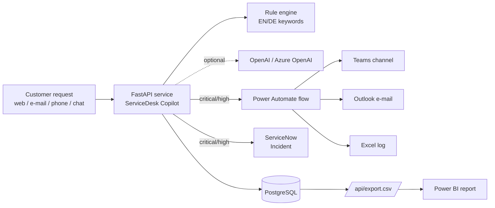

# ServiceDesk Copilot – Architecture

*Confluence page. Paste it into a new page: the editor converts Markdown when you paste it. For the diagram, use the **Mermaid** macro or attach a PNG export.*

## Purpose

Customer-service teams receive many requests in German and English, through web, e-mail, phone and chat. Somebody has to read each request and decide what it is about and how urgent it is before work can start. ServiceDesk Copilot does this first pass automatically and explains why. It escalates urgent cases to ServiceNow and to the team (Teams, Outlook), and it feeds a Power BI report.

## Overview

## Components

| Component | Technology | Notes |
|---|---|---|
| API + web UI | Python 3.12, FastAPI, vanilla JS | `/docs` = OpenAPI |
| Triage | Rule engine (always), LLM (optional) | The LLM may never lower a *critical* urgency |
| Database | PostgreSQL (Docker/K8s), SQLite (local/demo) | SQLAlchemy 2 |
| Container | Docker multi-stage, non-root | Healthcheck on `/healthz` |
| Orchestration | Kubernetes (kind locally / AKS) | Probes, HPA 2–5 pods, Postgres StatefulSet |
| Cloud | Azure Container Apps + Container Registry | Scale-to-zero |
| CI/CD | GitHub Actions | Tests → image → kind deploy; manual Azure deploy |
| ITSM | ServiceNow Table API | Incident per urgent ticket |
| Low-code | Power Automate, Power BI | Alerts, Excel log, reporting |
| Work tracking | Jira (Scrum), Confluence | Stories with acceptance criteria |

## Data flow for one ticket

1. `POST /api/tickets` → validation (Pydantic)
2. Triage: rules → (LLM if configured) → category, urgency, language, confidence, matched keywords
3. Save → reference `SDC-000123` → suggested reply in the customer's language
4. Respond `201` immediately
5. In the background, if critical/high: ServiceNow incident → save its number → call the Power Automate webhook

## Non-functional requirements

- **Availability:** integrations run in the background and their errors are only logged. Ticket creation never depends on ServiceNow, Power Automate or the LLM.
- **Security:** secrets only in env vars, K8s Secrets or Azure secrets, never in git. The container runs as non-root with a read-only filesystem on K8s.
- **Explainability:** every decision lists the keywords that caused it.
- **Data protection (GDPR):** demo data is synthetic. In production, the LLM would have to run in an EU region (Azure OpenAI EU) with a data-processing agreement, or be switched off.
